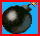
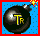
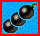
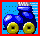
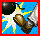
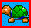

# Ausführliches Handbuch

[English version](MANUAL.md)

Wenn auf dem Rechner ein Markdown-Viewer installiert ist (z. B. VSCode), sollte man das Handbuch am besten lokal lesen, nachdem der cd_data_extractor gelaufen ist. Dann zeigt das Handbuch viele Grafiken, das macht es deutlich leichter lesbar.

## Spiel und Server starten

Um FPC Atomic im lokalen Netzwerk zu spielen, einfach auf jedem Rechner den FPC Atomic Client starten (fpc_atomic ausführen). Auf Wunsch lässt sich der Server auch im dedizierten Modus starten, siehe [Server-Befehle](#server-befehle). Dann müssen alle Clients "beitreten", weil der Server schon läuft. Der erste Client, der sich mit einem dedizierten Server verbindet, wird so behandelt, als hätte er das Spiel gestartet.

## Ein Spiel starten
Der erste Spieler ist der "Host" des Spiels, alle anderen Spieler treten dem Spiel bei.

Der Host wartet, bis alle Spieler verbunden sind, und wechselt dann mit "Return" zur Spielerauswahl. Je nach Teameinstellung (in den Optionen einstellbar) wählt jeder Spieler seine Farbe. Wenn alle ihre Farbe gewählt haben, stellt der Host mit "Return" das Spielfeld ein.

Ein weiteres "Return" startet die Runde. Eine Runde endet aus zwei Gründen: Entweder sind alle Spieler bis auf einen tot, oder im Zeitmodus ist die Zeit abgelaufen. Das wiederholt sich, bis der erste Spieler oder das erste Team die nötige Zahl an Siegen für das Match erreicht hat.

## Befehle im Spiel
Diese Befehle gibt es während des Spiels:
- "ESC" / Zurück: Zurück ins Hauptmenü (im Hauptmenü: Spiel beenden)
- "+": Lautstärke im Spiel erhöhen.
- "-": Lautstärke im Spiel verringern.
- "m": Musik im Spiel an- und ausschalten. Das geht auch im Optionen-Menü des Spiels.
- "j": Dialog für IP / Port öffnen, um sich mit einem Internet-Server zu verbinden.

## Powerups und Spielsteuerung
Diese Powerups gibt es im Spiel:  
 Eine Bombe mehr  
 Bomben fernzünden. Danach gibt es nur noch eine begrenzte Zahl Bomben, siehe [zweite Aktion](#zweite-aktion)  
 Alle verfügbaren Bomben auf einmal legen (spoogen). Schaltet das Greifen von Bomben ab, siehe [erste Aktion](#erste-aktion-doppelt-gedrückt)  
 Flammenlänge plus eins  
 Unendliche Flammenlänge  
 Laufgeschwindigkeit plus 10 % (höchstens 160 % der normalen Geschwindigkeit)  
 Bomben kicken. Dazu läuft der Spieler gegen eine Bombe  
 Gekickte Bomben prallen an Wänden ab  
 Bomben greifen. Schaltet das Spoogen von Bomben ab, siehe [erste Aktion](#erste-aktion-doppelt-gedrückt)  
 Bomben boxen, siehe [zweite Aktion](#zweite-aktion)  
 Zufälliges Powerup, kann gut oder schlecht sein  
 Laufgeschwindigkeit sinkt auf 60 % der normalen Geschwindigkeit  
 Eine zufällige Krankheit  
 Eine zufällige, besonders schlimme Krankheit  

## Tasten im Spiel
Die Tasten für beide Spieler an diesem PC stellt man im Launcher unter **Steuerung...** ein (oder im Spiel im Optionen-Menü). Jeder Spieler kann mit der Tastatur, einem Gamecontroller oder einem Joystick spielen. Details stehen in der [Anleitung der Steuerung](CONTROLS_MANUAL_DE.md) ([englische Version](CONTROLS_MANUAL.md)).

### Richtungstasten
- bewegen den Spieler in die gewünschte Richtung.
- Läuft der Spieler gegen eine Bombe, kickt er sie (wenn er das Powerup eingesammelt hat).

### Erste Aktion
- Bombe legen

### Erste Aktion (doppelt gedrückt)
- Bombe greifen und werfen (wenn der Spieler das Powerup eingesammelt hat), mit dem Mod [Bomben tragen](MODS_MANUAL_DE.md#bomben-tragen) aufheben und tragen
- Alle verfügbaren Bomben legen (wenn der Spieler das Powerup eingesammelt hat)

### Zweite Aktion
- Alle eigenen fernzündbaren Bomben zünden (die nicht gerade fliegen)
- Läuft der Spieler auf eine Bombe zu, boxt er sie in Laufrichtung (wenn er das Powerup eingesammelt hat)

## Spiel-Mods
FPC Atomic hat optionale Spiel-Mods (z. B. Stun bei Bombenlandung, positive Krankheit, Trefferpunkte pro Spieler, Geister) und einen Mod-Test-Modus. Alle sind standardmäßig aus und lassen sich im Launcher unter **Mods...** einstellen. Details stehen in der [Anleitung der Mods](MODS_MANUAL_DE.md) ([englische Version](MODS_MANUAL.md)).

## Grafiksätze
Neben den Originalgrafiken von der CD kann das Spiel eigene Grafiksätze nutzen, die der mitgelieferte Grafik-Generator berechnet (auch ohne CD). Den Satz wählt man im Launcher unter dem Bild links, **Grafiken...** öffnet den Generator. Details stehen in der [Anleitung der Grafiksätze](GRAPHICS_MANUAL_DE.md) ([englische Version](GRAPHICS_MANUAL.md)).

## Spieloptionen und Spielmodi
Die Spieloptionen (Teamspiel, Schema, Karte, Spielzeit, ...) lassen sich im Optionen-Menü des Spiels oder im Launcher unter **Spieloptionen...** einstellen. Neben dem klassischen Spiel gibt es den Spielmodus **Hunter**: Ein Spieler ist der Gejagte mit (fast) allen Items, wer ihn erwischt, wird der neue Gejagte. Den Spielmodus wählt man im Launcher unter **Spielmodus...**. Alle Optionen und Modi erklärt die [Anleitung der Spieloptionen](GAMEOPTIONS_MANUAL_DE.md) ([englische Version](GAMEOPTIONS_MANUAL.md)).

## Statistik (Highscore)
Der Server führt eine Statistik zu jedem Spieler: gespielte und gewonnene Matches und Runden, Kills, Tode, Eigentore, Spielzeit, Bomben, Items, Krankheiten und mehr. Der Launcher zeigt sie unter **Statistik...** (neben "Schließen").

- **Dieser Computer** sind die auf diesem PC gehosteten Spiele (die Dateien `Playerstats.csv` und `stats.txt` im Konfigurationsordner).
- Die Statistik zählt immer der Server, ein Spiel bei jemand anderem wird also auf dem PC des Hosts gezählt. Bei jedem Beitritt schickt der Server eine Kopie seiner Statistik, zu Beginn und am Ende eines Matches. Der Launcher zeigt diese Kopien unter "Dieser Computer" mit dem Namen des Server-PCs, der Adresse und dem Datum deines letzten Spiels dort. **Entfernen** löscht eine solche Kopie.
- Ein Klick auf einen Spaltenkopf sortiert, ein zweiter dreht die Reihenfolge um. **#** sortiert wieder nach Siegen. Sieg-% und K/D gibt es erst ab 3 Matches, sonst stünde ein Spieler mit 1 von 1 gewonnenem Match ganz oben.
- **Spieler** zeigt alle Spieler, nur Menschen oder nur die KI-Spieler. KI-Spieler sind grau, alle Plätze einer KI und Stufe zählen zusammen (z.B. "Smart Nitro"). Der eigene Name ist fett.
- **Tastenbelegungen zusammenfassen**: Ein Spieler zählt je Tastenbelegung (Tastatur 1 / 2) extra, angehakt ist der gleiche Name eine Zeile.
- **Alle Werte** zeigt auch die Spalten zu Bomben, Blöcken, Items und Krankheiten. Die Seite **Server** zeigt die Gesamtwerte des Servers (Matches, Runden, Spielzeit, Netzwerk).

Ist "Launcher nach dem Spiel wieder anzeigen" angehakt, öffnet der Launcher nach dem Spiel automatisch die Statistik des Servers, auf dem das letzte Match zu Ende ging (die eigene, wenn du gehostet hast, sonst die Kopie des anderen Servers). Abschalten lässt sich das unter **Spieloptionen...** mit "Statistik nach dem Spiel anzeigen".

Ein Spieler ist an Name und Tastenbelegung zu erkennen: Ein neuer Name beginnt eine neue Zeile, und auf anderen Servern kann jeder jeden Namen benutzen. Kills von KI-Spielern zählen mit. Die Werte sind also nur zum Spaß.

## Einen Client über das Internet mit einem lokalen Server verbinden
So verbindet man einen Client über das Internet mit einem Server:

#### Vorbereitung auf der Serverseite
1. Im Router zwischen dem Internet und dem Rechner, auf dem der Server laufen soll, eine Portweiterleitung einrichten
2. Den Server auf diesem Rechner starten: entweder dort ein Spiel hosten oder den Server im dedizierten Modus starten, siehe [Server-Befehle](#server-befehle)

#### Vorbereitung auf der Clientseite

* Im Hauptmenü "j" drücken und IP / Port des Servers eingeben, um beizutreten

oder

* Den Client mit diesen Kommandozeilenparametern starten: 
 -ip \<IP-Adresse des Servers\>: die IP-Adresse des Routers, mit dem der Server verbunden ist. 
 -port \<weitergeleiteter Port\>: der Port, den der Router an den Port des Servers weiterleitet.

 Stimmen IP-Adresse und Port, verbindet sich der Client automatisch mit dem Server. Startet man den Client neu oder hostet ein neues Spiel, gelten die Parameter nicht mehr und das Spiel funktioniert wieder "normal".

## Server-Befehle
Normalerweise muss man sich nicht um den Server kümmern. fpc_atomic startet ihn automatisch, wenn ein Spiel gehostet wird. Auf Wunsch lässt sich der Server auch im dedizierten Modus nutzen. Der erste Client, der sich mit einem dedizierten Server verbindet, ist der Host, der Server spielt dann mit den [Mods](MODS_MANUAL_DE.md) dieses Clients.

Für den dedizierten Modus den Server mit diesen Kommandozeilenparametern starten:
- -h: Online-Hilfe des Servers (zeigt weitere Informationen)
- -p \<port\>: der Port, auf dem der Server lauscht (Pflicht)
- -t \<zeit\>: Timeout in Sekunden, nach dem sich der Server beendet, wenn kein Spieler verbunden ist. 0 schaltet den Timeout ab.
- -l \<level\>: das Log-Level (Standard 2)
- -ats \<speed\>: die normale Atomic-Geschwindigkeit (Standard 5)
- -bind \<IP\>: nur auf dieser Adresse lauschen, z. B. 127.0.0.1 für ein Spiel nur auf diesem PC (keine Firewall-Abfrage, niemand sonst kann beitreten)
- -ai \<Name\>: die KI der Computerspieler, z. B. ai_smart für die [Smart-KI](ai_smart/README_DE.md) (ai_smart.dll / libai_smart.so). Ohne den Parameter, oder wenn die Datei fehlt, die originale KI (hostet das Spiel, wird die Launcher-Einstellung „KI“ übergeben)

Hostet das Spiel selbst, lässt der Parameter **-localhost** von fpc_atomic den Server nur auf 127.0.0.1 lauschen. Der Parameter **-assets \<Ordner\>** von fpc_atomic wählt einen [Grafiksatz](GRAPHICS_MANUAL_DE.md) (der Launcher übergibt ihn automatisch).

### Konsolenbefehle
Während der Server läuft, gibt es im Konsolenfenster diese Befehle:
- "u": Die aktuelle KI-Bibliothek entladen.
- "a": Eine neue KI laden.
- "ESC": Server sofort beenden

### Launcher-Befehle

Seit Version 0.08 kennt der Launcher Kommandozeilenparameter:
- -ip \<IP\>: füllt das Feld "Router-IP" mit \<IP\> vor
- -port \<port\>: füllt das Feld "Port" mit \<port\> vor
- -cti: hakt "Über einen Router beitreten" an

Im Launcher startet **Strg + Klick auf "FPC Atomic starten"** (oder Strg+Alt+L) das Spiel und hostet direkt ein Netzwerkspiel, ohne Hauptmenü (das Spiel bekommt den Parameter -host). **Shift + Klick** (oder Shift+Alt+L) tritt direkt einem Netzwerkspiel bei (Parameter -join): Das Spiel sucht im lokalen Netz, findet es kein Spiel, fragt es nach IP und Port. Ist „Über einen Router beitreten“ angehakt, tritt das Spiel immer dem dort eingetragenen Server bei, mit oder ohne Shift. Der Knopf **Spieloptionen...** stellt die Optionen des Spiels ein (Teamspiel, Schema, Spielzeit, ...), ohne es zu starten. Dort lässt sich auch die Karte wählen, eine Vorschau zeigt sie mit allen Steinen des Schemas. Dort lassen sich auch die Soundeffekte abschalten, unabhängig von der Musik ("Musik abspielen" im Launcher).

Der Link unten rechts im Launcher schaltet zwischen Englisch und Deutsch um. Auf Deutsch öffnen die Links im Launcher die deutschen Handbücher.

## Mitgelieferte KI
Der Server lädt beim Start automatisch ai.so (unter Windows ai.dll). Mit den [Konsolenbefehlen](#konsolenbefehle) lässt sich die KI während des Spiels entladen und ändern. Das soll bei der Entwicklung einer KI helfen.

### KI-Entwicklung
Siehe den Abschnitt [What needs to be done to implement a own AI](README.md#what-needs-to-be-done-to-implement-a-own-ai) in der README.md (englisch).
