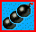

# Game mods

[Deutsche Version](MODS_MANUAL_DE.md)

FPC Atomic has some optional game mods that change the rules of the original game. All mods are **off by default**, so without changing anything the game plays exactly like the original.

- [Setting up the mods](#setting-up-the-mods)
- [Stun on bomb landing](#stun-on-bomb-landing)
- [Boxing glove](#boxing-glove)
- [Positive disease](#positive-disease)
- [Walk through bricks](#walk-through-bricks)
- [White screen](#white-screen)
- [White bomb](#white-bomb)
- [Flamethrower](#flamethrower)
- [Hit points (handicap)](#hit-points-handicap)
- [Ghosts](#ghosts)
- [Glove at start](#glove-at-start)
- [Open borders](#open-borders)
- [Teleporters](#teleporters)
- [Mod test mode](#mod-test-mode)
- [Editing atomic_server.ini by hand](#editing-atomic_serverini-by-hand)

## Setting up the mods

The mods are a setting of the **server**, so only the PC that hosts the game needs them. All other players get the rules from the server, they do not need to change anything.

The easiest way is the launcher: click **Mods...**, check the mods you want on the left and adjust their values on the right. Click **OK** to save. The settings apply to the **next game that is hosted on this PC** (the server reads them when it starts).

The settings are stored in `atomic_server.ini` in the config folder (launcher: **Config folder**), see [Editing atomic_server.ini by hand](#editing-atomic_serverini-by-hand).

### Common rules

- **Invulnerable players** blink white (red, if their own color is white). Flames do not hurt them and they cannot be stunned.
- **Stunned players** blink black (red, if their own color is black).
- **Hurry ends all protection:** when the hurry starts (80 s before the end of the round), every invulnerability ends, all ghosts vanish and every hit is lethal. In rounds with infinite time there is no hurry.
- When several protection times overlap, the longest one counts, they are not added.

## Stun on bomb landing

A bomb that is **thrown** (grab, see [first action](MANUAL.md#first-action-double-pressed)) and lands on a player stuns this player. A stunned player can neither move nor use any action. Punched bombs do not stun.

The stun hits everyone on the tile: opponents, team mates and the thrower. Invulnerable players are immune.

| Setting | ini key | Default | Range |
|---|---|---|---|
| Mod on / off | `StunOnBombLanding` | 0 (off) | 0 / 1 |
| Min. stun time (ms) | `StunMinMs` | 100 | 0 .. 10000 |
| Max. stun time (ms) | `StunMaxMs` | 500 | 0 .. 10000, not smaller than min. |

The stun time is random between min. and max.

## Boxing glove

With the punch item  the [second action](MANUAL.md#second-action) stuns an **opponent** who stands on the tile in front of the player (in the direction the player looks). This works also while standing still.

- If a bomb lies on the same tile, only the opponent is stunned and the bomb stays where it is. Without an opponent the bomb is punched as usual.
- Team mates, invulnerable, flying and dying players are not stunned.
- After a punch the same player has to wait a moment before the next punch, so nobody can be stunned all the time.

| Setting | ini key | Default | Range |
|---|---|---|---|
| Mod on / off | `PunchStun` | 0 (off) | 0 / 1 |
| Min. stun time (ms) | `PunchStunMinMs` | 300 | 0 .. 10000 |
| Max. stun time (ms) | `PunchStunMaxMs` | 800 | 0 .. 10000, not smaller than min. |
| Wait before next punch (ms) | `PunchStunCooldownMs` | 1500 | 0 .. 10000 |

## Positive disease

A part of the disease items  makes the player **invulnerable** for a random time instead of sick. The player cannot see when the protection ends.

During hurry a disease item is always a normal disease. The super bad disease  is not changed.

| Setting | ini key | Default | Range |
|---|---|---|---|
| Mod on / off | `PositiveDisease` | 0 (off) | 0 / 1 |
| Chance of a disease item (%) | `PositiveDiseaseChance` | 15 | 0 .. 100 |
| Min. invulnerable time (ms) | `PositiveMinMs` | 5000 | 0 .. 120000 |
| Max. invulnerable time (ms) | `PositiveMaxMs` | 20000 | 0 .. 120000, not smaller than min. |

## Walk through bricks

A part of the disease items  lets the player walk **through destructible bricks** for a random time instead of making the player sick. Solid blocks stay solid. While the effect lasts, the player is drawn see-through.

- If the time ends inside a brick, the player can only walk out of it. Further bricks can only be entered while there is no free tile next to the player, so nobody gets locked in.
- No bombs can be placed inside a brick.
- If the brick explodes while the player is inside, the player is hit like by a flame.
- Items hidden in a brick can only be picked up after the brick is gone.
- During hurry a disease item is always a normal disease, and a running effect ends (the player can still walk out of a brick).
- If the [positive disease](#positive-disease) is also on, it is rolled first. The chance here applies to the remaining disease items.

| Setting | ini key | Default | Range |
|---|---|---|---|
| Mod on / off | `BrickWalk` | 0 (off) | 0 / 1 |
| Chance of a disease item (%) | `BrickWalkChance` | 15 | 0 .. 100 |
| Min. time (ms) | `BrickWalkMinMs` | 5000 | 0 .. 120000 |
| Max. time (ms) | `BrickWalkMaxMs` | 10000 | 0 .. 120000, not smaller than min. |
| See-through (%) | `BrickWalkTransparency` | 50 | 0 .. 100, 0 = normal, 100 = invisible |

The see-through effect is made by drawing the player only in a part of the frames, so it may flicker a little.

## White screen

A part of the disease items  turns the screen of the player white for a while instead of a normal disease. The screen stays white for a set time and then fades back.

- It is rolled after the positive effects ([positive disease](#positive-disease), [walk through bricks](#walk-through-bricks)).
- AI players are not affected.
- If two players play on one PC, that PC shows no white screen, because both share the screen.

| Setting | ini key | Default | Range |
|---|---|---|---|
| Mod on / off | `FlashDisease` | 0 (off) | 0 / 1 |
| Chance of a disease item (%) | `FlashDiseaseChance` | 15 | 0 .. 100 |
| Strength (%) | `FlashDiseaseIntensity` | 90 | 0 .. 100, 100 = nothing can be seen |
| Duration (ms) | `FlashDiseaseMs` | 2500 | 0 .. 10000 |
| Fade back (ms) | `FlashDiseaseFadeMs` | 2000 | 0 .. 10000 |

## White bomb

A part of the items below the bricks are **white bombs**. They look like a white extra bomb item. After picking one up, the next placed bomb is a white bomb (drawn in gray, so it is not mixed up with the bombs of the white player):

- It explodes after the normal time, but without flames, so it destroys nothing and kills nobody.
- It turns the screens of **all opponents** on the whole field white, like the [white screen](#white-screen) disease. Team mates and the player who placed it are not affected.
- It is an extra bomb. It does not count to the bombs of the player, afterwards the player places normal bombs again.
- It can be kicked, thrown and punched like any other bomb.

| Setting | ini key | Default | Range |
|---|---|---|---|
| Mod on / off | `WhiteBomb` | 0 (off) | 0 / 1 |
| Share of the items (%) | `WhiteBombChance` | 10 | 0 .. 100 |
| Strength (%) | `WhiteBombIntensity` | 90 | 0 .. 100, 100 = nothing can be seen |
| Duration (ms) | `WhiteBombMs` | 2500 | 0 .. 10000 |
| Fade back (ms) | `WhiteBombFadeMs` | 2000 | 0 .. 10000 |

## Flamethrower

A part of the items below the bricks are **flamethrowers**. They look like a red flame item  with a red frame. While the player has fuel, **holding the second action** fires a beam in the direction the player looks.

- The beam reaches a set number of tiles. It stops at bricks and solid blocks without destroying them, and at bombs.
- A bomb that stays in the beam for a set time without a break is ignited (default: 1 second). Trigger bombs too, a dud bomb does not explode but just disappears, and its owner gets the bomb back. The kill goes to the owner of the bomb. Igniting can be switched off, then a bomb is a shield against the beam.
- Items in the beam burn at once, like with a flame. This can be switched off, then the beam goes over them.
- An opponent who stays in the beam for a set time without a break is hit like by a flame. Leaving the beam resets the time. Team mates are only hurt with friendly fire switched on, the beam never hurts the player firing it.
- The fuel is only used up while firing. When it is empty, the flamethrower is gone. More flamethrower items add fuel.
- While the player has fuel, the second action does not trigger or punch bombs.
- The player can walk normally while firing, the beam turns with the player.
- If the key is released while the game window has no focus (e.g. Alt+Tab), the game does not notice it: the beam keeps firing until the key is pressed and released again in the game.
- In the mod test mode F4 (all items) also gives fuel.

| Setting | ini key | Default | Range |
|---|---|---|---|
| Mod on / off | `FlameThrower` | 0 (off) | 0 / 1 |
| Share of the items (%) | `FlameThrowerChance` | 5 | 0 .. 100 |
| Fuel per item (ms) | `FlameThrowerFuelMs` | 5000 | 0 .. 60000 |
| Range (tiles) | `FlameThrowerRange` | 3 | 1 .. 14 |
| Time to kill (ms) | `FlameThrowerKillMs` | 2000 | 0 .. 10000 |
| Hurt team mates (friendly fire) | `FlameThrowerFriendlyFire` | 0 (off) | 0 / 1 |
| Burn items in the beam | `FlameThrowerBurnItems` | 1 (on) | 0 / 1 |
| Ignite bombs in the beam | `FlameThrowerIgniteBombs` | 1 (on) | 0 / 1 |
| Time to ignite (ms) | `FlameThrowerIgniteMs` | 1000 | 0 .. 10000 (0 = at once) |

## Hit points (handicap)

Players survive several hits. Each hit costs one hit point (also a hit by the own bomb) and makes the player invulnerable for a short time, so the same flame does not hit twice. Only the last hit is lethal and only this one counts as a kill.

The hit points are set **per player name** in a handicap table, so weaker players can get more hit points than strong ones. All players that are not in the table get the default hit points. The hit points are refilled at the start of each round.

During hurry every hit is lethal, no matter how many hit points are left.

| Setting | ini key | Default | Range |
|---|---|---|---|
| Mod on / off | `HitPoints` | 0 (off) | 0 / 1 |
| Invulnerable after a hit (ms) | `InvulnTimeMs` | 5000 | 500 .. 60000 |
| Default hit points | `DefaultHitPoints` | 1 | 1 .. 255 |
| Show hit points above the players | `ShowHitPoints` | 1 (on) | 0 / 1 |
| Handicap table | section `[Handicap]` | empty | `Player name=hit points`, 1 .. 255 |

**Two players on one PC:** the second player on a PC (keyboard 2) has the same player name as the first one. Use `Name~2` in the handicap table for the second player, e.g.

```ini
[Handicap]
Anna=3
Anna~2=1
```

When shown, the number above a player is only visible while the player has more than 1 hit point.

AI players have no player name, so they always get the default hit points.

## Ghosts

A player that dies does not leave the round but walks on as a small, flickering **ghost** on a frame around the field (outside the playing field).

- **Moving:** The direction keys move the ghost along the frame. When it stops, it always looks into the field.
- **Throwing:** The [first action](MANUAL.md#first-action) throws a ghost bomb straight into the field: it flies 3 tiles from the edge into the row or column in front of the ghost. Only one ghost bomb can be on its way at a time. The flame length of the ghost bomb is a setting.
- **Coming back:** If the flame of a ghost bomb hits an **opponent** (team mates do not count), the ghost comes back into the game at the start position (or the next free tile). The player gets the abilities of the scheme (the items were spread at death), full hit points and is invulnerable for a short time.
- The ghost gets no kill for a ghost bomb. The hit player dies (or loses a hit point) as usual.
- If [Stun on bomb landing](#stun-on-bomb-landing) is on, ghost bombs stun like thrown bombs.
- **Limits:** A player can become a ghost only a limited number of times per round. A ghost that hits no opponent within a set time vanishes. In the last 5 s before it vanishes it flickers faster.
- With the hurry all ghosts vanish.
- The round ends as usual when only one player (or team) is left alive, ghosts do not count. So ghosts only matter with 3 or more players.

| Setting | ini key | Default | Range |
|---|---|---|---|
| Mod on / off | `Ghosts` | 0 (off) | 0 / 1 |
| Flame length of the ghost bomb | `GhostFlameLen` | 2 | 1 .. 99 |
| Invulnerable after coming back (ms) | `GhostReviveInvulnMs` | 3000 | 0 .. 60000 |
| Max. times ghost per round | `GhostMaxCount` | 1 | 0 .. 99, 0 = unlimited |
| Max. time as ghost (ms) | `GhostMaxTimeMs` | 0 | 0 .. 600000, 0 = unlimited |
| Flicker time (ms) | `GhostFlickerMs` | 200 | 0 .. 5000, 0 = no flicker |

The flicker time is the length of one tick: a ghost is visible for 3 ticks and invisible for 1 tick.

## Glove at start

Sometimes a round starts in a small pocket between bricks, and a bomb placed by accident locks the player in. With this mod every player can throw the bomb below the player like with the glove  (press the [first action](MANUAL.md#first-action-double-pressed) twice), **until the first step** of the round.

- Pressing a direction key against a wall only turns the player without a step, so the throw can be aimed.
- Players with the spooger  spooge as usual instead.
- A ghost that comes back into the game does not get the glove again.

| Setting | ini key | Default | Range |
|---|---|---|---|
| Mod on / off | `GloveAtStart` | 0 (off) | 0 / 1 |

## Open borders

Players can walk over the border of the field and come out on the opposite side, top <-> bottom and / or left <-> right.

- The borders open a set time after the start of a round, so nobody can flee from the start corner at once.
- Yellow arrows on the frame around the field show which borders are open. They blink during the last 3 s before the borders open.
- A player standing in the middle of a border tile who keeps walking outwards is at once on the opposite tile and walks on there.
- If the opposite tile is blocked (brick, solid block, bomb), the border works like a wall.
- Only players go over the border. Kicked bombs and flames stop at the border as usual.
- With the hurry the borders close again.

| Setting | ini key | Default | Range |
|---|---|---|---|
| Mod on / off | `OpenBorders` | 0 (off) | 0 / 1 |
| Top <-> bottom | `OpenBordersTopBottom` | 1 (on) | 0 / 1 |
| Left <-> right | `OpenBordersLeftRight` | 1 (on) | 0 / 1 |
| Open after (s) | `OpenBordersActiveSec` | 30 | 0 .. 600, 0 = from the start |

## Teleporters

Teleporters in the middle of the borders bring the player to the teleporter on the opposite border, top <-> bottom and / or left <-> right. They work like the holes of some maps and look like them, with a turquoise ring around.

- The teleporters appear a set time after the start of a round. Before that they are normal tiles.
- The teleporter tiles stay free from the start, and the tiles next to them have no bricks (solid blocks stay).
- No bombs can be placed on a teleporter, rolling bombs stop in front of it.
- During hurry the teleporters are gone.

| Setting | ini key | Default | Range |
|---|---|---|---|
| Mod on / off | `Teleporters` | 0 (off) | 0 / 1 |
| Top <-> bottom | `TeleportersTopBottom` | 1 (on) | 0 / 1 |
| Left <-> right | `TeleportersLeftRight` | 1 (on) | 0 / 1 |
| Appear after (s) | `TeleportersActiveSec` | 60 | 0 .. 600, 0 = from the start |

## Mod test mode

The mod test mode helps to try the mods without waiting for the right situation in a game. **It is meant for testing only:** while it is on, all players see the hint `MOD TEST MODE - F3: HELP` at the bottom of the screen, and the remaining invulnerable (`I`), stun (`S`) and walk through bricks (`B`) times above the players.

Only the player who hosts the game (the master) can use the test keys during a round:

| Key | Effect |
|---|---|
| F3 | Show / hide the help with all test keys |
| F4 | All items (bombs, kick, punch, grab, ...) |
| F5 | Positive disease (invulnerable) |
| F6 | Hit me (costs a hit point or kills) |
| F7 | Make me a ghost / bring me back |
| F8 | Start the hurry now |
| F9 | Stun me |
| F11 | Refill my hit points |
| F12 | Walk through bricks |
| F2 | White screen |
| F1 | Next bomb is a white bomb |
| Ins | Spawn 2 of each mod item on free tiles: white bomb, flamethrower, punch, disease |

Hold **Shift** to use the key on the second player of this PC. F10 is not used, because Windows uses it for the window menu.

The test keys ignore the limits of the mods (e.g. F7 works more often than `GhostMaxCount`), so edge cases can be tested.

These settings only work while the mod test mode is on:

| Setting | ini key (section `[Debug]`) | Default | Range |
|---|---|---|---|
| Mod test mode on / off | `ModTestMode` | 0 (off) | 0 / 1 |
| Start items | `StartItems` | empty | e.g. `kick,punch,grab,bomb*3` |
| Round time (s) | `RoundTimeSec` | 0 | 0 .. 3600, 0 = time from the game settings |
| Invulnerable at start (ms) | `StartInvulnMs` | 0 | 0 .. 600000 |
| Ghosts count as alive | `GhostsKeepRound` | 0 (off) | 0 / 1 |

- **Start items:** every player gets these items at the start of each round. Comma separated, `*n` takes an item n times. Possible items: `bomb`, `flame`, `goldflame`, `speed`, `kick`, `punch`, `grab`, `spooger`, `jelly`, `trigger`. Put `trigger` behind `bomb`, it applies to the bombs before it.
- **Round time:** the hurry starts at 80 s remaining, so `90` starts the hurry after 10 s.
- **Ghosts count as alive:** the round does not end while ghosts are left, so ghosts can be tested with only 2 players.

## Editing atomic_server.ini by hand

The file is in the config folder of FPC Atomic:

- Windows: `%LOCALAPPDATA%\fpc_atomic\atomic_server.ini`
- Linux: `~/.config/fpc_atomic/atomic_server.ini`

Example:

```ini
[Mods]
; Comments are only allowed in their own line
StunOnBombLanding=1
StunMinMs=100
StunMaxMs=500
Ghosts=1
GhostMaxCount=1

[Debug]
ModTestMode=0

[Handicap]
Anna=3
Anna~2=1
```

Please note:

- **No comments behind values.** A comment must be in its own line starting with `;`. `HitPoints=0 ; off` is read as "on", numbers with a comment behind fall back to their default.
- `1` means on, `0` means off.
- If a key is listed twice, the first one counts.
- Missing keys are added with their default value when the server starts, so all keys can be found in the file.
- Invalid values are set to the nearest valid value. The server log (config folder, `log/server.log`) shows a warning for each of them.
- The server reads the file only when it starts. Changes apply to the next hosted game.
- The **Mods...** dialog of the launcher writes the section `[Handicap]` completely new. Comments in this section get lost, comments in all other sections are kept.
